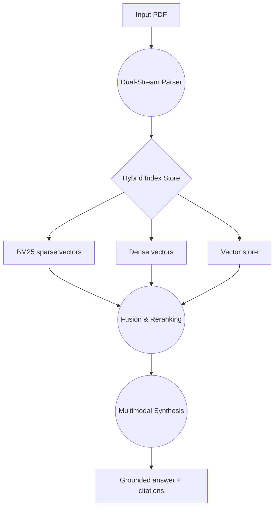
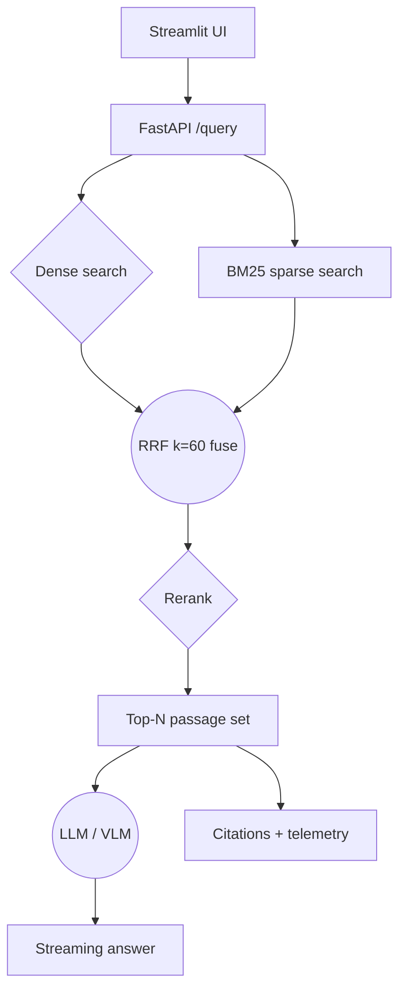

# Flowcharts

End-to-end architecture and the live query path. Both diagrams are written in
[Markdown](https://daringfireball.net/projects/markdown/) and rendered to PNG
with [Mermaid](https://mermaid.js.org/). The `.png` files are checked in so
GitHub renders them in the project README without a JS dependency.

## 1. Pipeline architecture



## 2. Live query path



## Rendering

```bash
# Fast:
npx @mermaid-js/mermaid-cli -i docs/flowchart.md -o docs/flowchart.png

# Slower but more deterministic:
npm i -g @mermaid-js/mermaid-cli
mmdc -i docs/flowchart.md -o docs/flowchart.png
```
